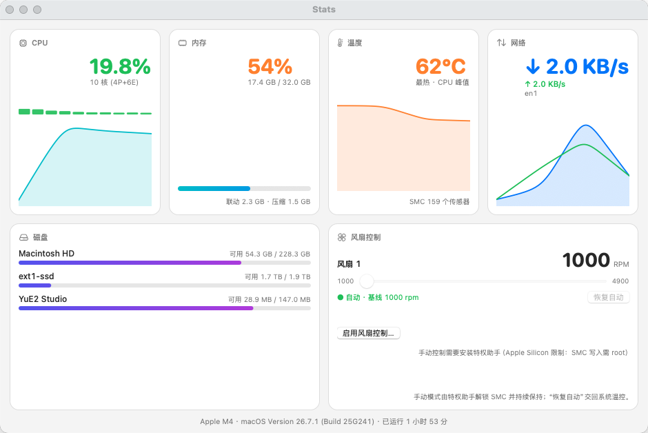

# Stats — Mac 系统监视 + 风扇控制

Native macOS system monitor & fan control for Apple Silicon Macs — CPU / memory / disk / network / temperatures in real time, plus manual fan speed control. Pure AppKit + IOKit, zero third-party dependencies, builds with just the Xcode Command Line Tools.

为 Mac mini（Apple Silicon，实测 M4 / macOS 26）编写的原生系统监视 App：CPU、内存、磁盘、网速、温度传感器实时监控，以及风扇手动转速控制。纯 AppKit + IOKit，无第三方依赖，只需 Xcode Command Line Tools 即可构建。

> 注：与 GitHub 上知名的 macOS 监视工具 [exelban/Stats](https://github.com/exelban/stats) 无关，仅为个人项目重名。



## 功能

- **CPU**：总占用 + 每核心占用柱状条 + 历史曲线（P/E 核数识别）
- **内存**：已用/总量、联动(Wired)、压缩内存、Swap，进度条
- **网络**：实时上下行速率（B/s）、双曲线历史图、按接口（en0/utun…）分解
- **磁盘**：各卷容量/可用空间（自动过滤系统隐藏卷）
- **温度**：枚举全部 SMC 温度传感器（Apple Silicon 机型通常有上百个），按温度取最热 28 个展示，颜色分级（蓝<45 / 绿<60 / 橙<75 / 红≥75°C），P核心/E核心/GPU 中文标注
- **风扇**：实时 RPM、最小/最大转速、当前模式（自动/手动/系统温控）、目标转速；快捷档位按本机风扇 min/max 自适应
- **菜单栏**：常驻状态项显示 `⚙︎ CPU% 温度 风扇RPM`，点击展开快捷指标

## 风扇控制（Apple Silicon 专属说明）

Apple Silicon 上 SMC 风扇写入被固件限制为 **root**，且 M3/M4 需要先进入诊断模式解锁。原理（参考 [agoodkind/macos-smc-fan](https://github.com/agoodkind/macos-smc-fan)）：

```
Ftst = 1            # 进入诊断模式，抑制 thermalmonitord 抢回控制
等待 F0Md 从 3 释放   # 约 3-4 秒
F0Md = 1            # 切手动模式（100ms 间隔重试，最多 10 秒）
F0Tg = 目标转速      # float，直接写目标 RPM
```

因此 App 采用 **特权助手架构**：

- App 本体无特权，负责全部读取与展示
- 首次点击「启用风扇控制…」时，经管理员密码安装一个 LaunchDaemon
  （`/Library/PrivilegedHelperTools/com.hhq.stats.fanhelper` 是**指向 App 内二进制的符号链接**），
  通过 unix socket `/tmp/com.hhq.stats.fanhelper.sock` 接收命令
- **日常调节转速不弹密码**；密码只在安装/更新助手时弹
- 因为助手是符号链接，以后 App 更新（重新 make-app）后启动时会自动让 launchd 重拉助手加载新版
  （版本握手 ping `ver=N`，App 检测到旧版自动 restart），**无需再输密码**
- 助手每 4 秒确认手动模式仍生效（thermalmonitord 会抢回、睡眠唤醒后 Ftst 清零，都会自动恢复）
- 「恢复自动」→ `F0Md=0`，最后一个手动风扇恢复时 `Ftst=0`，交回系统温控
- 重启/卸载助手后一切回到系统默认，无残留

> ⚠️ 手动模式下固件仍保留临界保护（超温会强制降频），但请勿长期把转速压到远低于散热需求的水平。

## 构建 & 运行

要求：macOS 13+，Xcode Command Line Tools（`xcode-select --install`，无需完整 Xcode）。监控功能全机型可用；风扇手动控制目前只在 Apple Silicon（M3/M4 路径）上验证过。

```bash
./scripts/make-app.sh          # release 构建 + 组装 build/Stats.app（含图标 + ad-hoc 签名）
open build/Stats.app           # 运行（菜单栏 App，无 Dock 图标）
```

命令行调试模式（同一个二进制）：

```bash
.build/debug/Stats --cli               # 一次性 JSON 输出全部指标（含温度/风扇全量数据）
.build/debug/Stats --watch             # 每 2 秒一行实时概览
.build/debug/Stats --smc-debug         # SMC 底层调试（key 枚举、写入实验）
.build/debug/Stats --fan-test 3500 10  # 风扇实测：设 3500rpm 观察 10 秒后恢复自动（需助手已安装）
.build/debug/Stats --helper-install    # 终端安装特权助手（等价 App 内按钮）
.build/debug/Stats --helper-uninstall  # 卸载特权助手
```

## 卸载

- 退出 App：菜单栏 ⚙︎ → 退出
- 移除特权助手：`build/Stats.app/Contents/MacOS/Stats --helper-uninstall`（会弹管理员密码框）
- 删除 App：直接删 `build/Stats.app`

## 技术要点

| 模块 | 实现 |
|---|---|
| SMC 通信 | IOKit `AppleSMC` user client，80 字节结构体协议（READ_KEYINFO=9 / READ_BYTES=5 / WRITE_BYTES=6 / READ_INDEX=8） |
| 温度解码 | Apple Silicon 为 `flt `（float32 **小端**，读写皆然），Intel 机型为 `sp78`（7.8 定点），两者兼容 |
| 风扇转速 | `F{n}Ac/Mn/Mx/Tg`，AS 上同为 `flt `；模式 `F{n}Md`（0 自动/1 手动/3 系统温控） |
| CPU | `host_processor_info` tick 差分，逐核 + 总占用 |
| 内存 | `host_statistics64`（active+wired+compressed），swap 来自 `vm.swapusage` |
| 网速 | `getifaddrs(AF_LINK)` 计数器差分，排除 lo0 |
| 磁盘 | `getmntinfo` + 卷显示名（`NSURLVolumeLocalizedNameKey`） |
| UI | 纯 AppKit（NSStackView/NSGridView + CoreGraphics 自绘图表），因为 CLT 环境下 SwiftUI `@State` 宏不可用 |

## 文件结构

```
Sources/Stats/
├── main.swift          # 入口：--fan-daemon / CLI 模式分流 / GUI 启动
├── SMC.swift           # AppleSMC 客户端（key 读写、类型解码、key 枚举）
├── Sensors.swift       # 温度传感器服务 + 风扇状态读取
├── SystemMetrics.swift # CPU/内存/磁盘/网络采样器 + 格式化
├── FanHelper.swift     # 特权风扇守护进程 + unix socket 客户端 + 安装/卸载
├── Store.swift         # 每秒采样的全局状态
├── AppKitUI.swift      # 主窗口（卡片式仪表盘）
└── AppDelegate.swift   # 窗口/菜单栏/生命周期
scripts/
├── make-icon.swift     # 程序生成 App 图标（仪表盘）
└── make-app.sh         # release 构建打包
```

## 已知限制

- 风扇手动控制在 M3/M4+ 上依赖诊断模式解锁（上述序列）；Intel / M1 / M2 机型未实测（写入路径可能不同）
- 温度只展示最热 28 个（全量可用 `--cli` 查看）
- 助手 socket 权限 0666：本机任意用户可发命令（个人机可接受，多用户环境请注意）

## License

[MIT](LICENSE)
